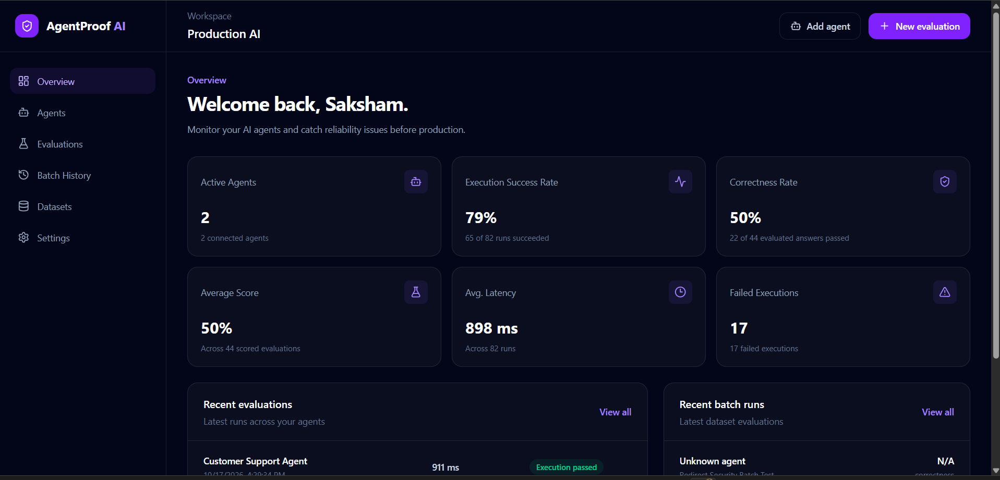
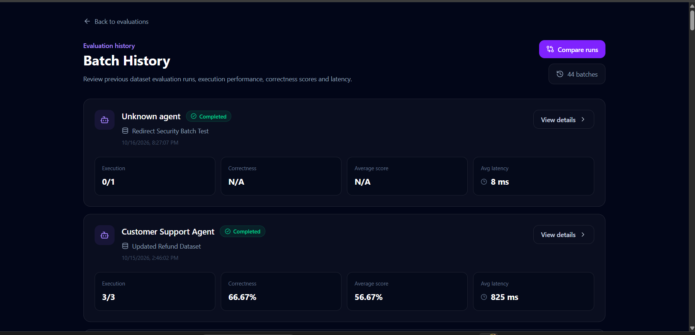
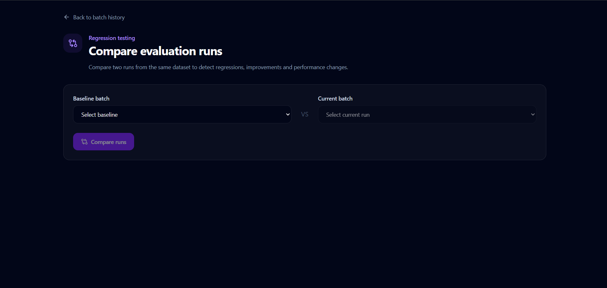

<div align="center">

# 🛡️ AgentProof AI

### AI Agent Evaluation & Reliability Platform

<p>
  Test AI agents before production.<br/>
  Measure correctness, reliability, latency, hallucination risk, and regressions.
</p>

<p>
  <a href="https://agentproof-ai.vercel.app/">
    
  </a>

  <a href="https://agentproof-ai-api.onrender.com/api/health">
    
  </a>

  <a href="https://github.com/SaKshDEV/agentproof-ai">
    
  </a>
</p>

<p>
  
  
  
  
  
  
  
</p>

</div>

---

<div align="center">

## ✨ What is AgentProof AI?

<p>
  <b>AgentProof AI</b> is a full-stack platform for evaluating AI agents
  before they are deployed to real users.
</p>

<p>
  It helps developers measure <b>correctness</b>, <b>reliability</b>,
  <b>latency</b>, <b>hallucination risk</b>, and <b>regressions</b>
  through structured evaluation workflows.
</p>

</div>

<br/>

<table>
<tr>

<td width="50%" valign="top">

### 🧪 Agent Evaluation

Run AI agents against structured test inputs and analyze their responses.

<br/>

**Includes**

`Single Evaluations`  
`Batch Evaluations`  
`Reusable Test Datasets`

</td>

<td width="50%" valign="top">

### 🧠 Semantic AI Judge

Evaluate meaning and correctness instead of relying only on exact text matches.

<br/>

**Includes**

`Semantic Scoring`  
`Correctness Analysis`  
`Groq-powered Evaluation`

</td>

</tr>

<tr>

<td width="50%" valign="top">

### ⚠️ Hallucination Detection

Identify potentially unreliable or unsupported AI responses during evaluation.

<br/>

**Includes**

`Hallucination Risk`  
`Evaluation Reasoning`  
`Reliability Signals`

</td>

<td width="50%" valign="top">

### 📊 Reliability Analytics

Track how your agents perform across evaluation runs and datasets.

<br/>

**Includes**

`Success Rate`  
`Correctness Score`  
`Latency Tracking`

</td>

</tr>

<tr>

<td width="50%" valign="top">

### 🔄 Regression Testing

Compare evaluation batches to understand whether a new agent version improved or degraded.

<br/>

**Includes**

`Batch Comparison`  
`Performance Changes`  
`Regression Detection`

</td>

<td width="50%" valign="top">

### 🔐 Secure Agent Connections

Connect external AI agents while keeping their authentication credentials protected.

<br/>

**Includes**

`Bearer Tokens`  
`API Keys`  
`Encrypted Credentials`

</td>

</tr>
</table>

<br/>

<div align="center">

### Built to answer one important question:

<p>
  <b><i>“Is this AI agent actually ready for production?”</i></b>
</p>

</div>

---

<div align="center">

## 📸 Product Preview

<p>
  Explore AgentProof AI's dashboard, evaluation history, and regression testing workflow.
</p>

</div>

<br/>

### 📊 Reliability Dashboard

<p align="center">
  
</p>

<br/>

<table>
<tr>

<td width="50%" valign="top">

### 🧪 Batch Evaluation History



</td>

<td width="50%" valign="top">

### 🔄 Regression Comparison



</td>

</tr>
</table>

<br/>

<div align="center">

<a href="https://agentproof-ai.vercel.app/">
  
</a>

</div>

---

<div align="center">

## 🏗️ System Architecture

<p>
  AgentProof AI separates the user interface, API layer, persistent storage,
  external agent execution, and AI evaluation responsibilities.
</p>

</div>

<br/>

<div align="center">

<table>
<tr>

<td align="center" width="28%">

### 🌐 Frontend

**React + Vite**

Dashboard  
Agent Management  
Datasets  
Evaluations  
Analytics

</td>

<td align="center" width="6%">

### →

</td>

<td align="center" width="32%">

### ⚙️ Backend API

**Node.js + Express**

Authentication  
Agent Execution  
Batch Processing  
Evaluation Engine  
Security Layer

</td>

<td align="center" width="6%">

### →

</td>

<td align="center" width="28%">

### 🗄️ Database

**MongoDB Atlas**

Users  
Agents  
Datasets  
Evaluation Runs  
Evaluation Batches

</td>

</tr>
</table>

<br/>

<table>
<tr>

<td align="center" width="35%">

### ⚙️ AgentProof Backend

Evaluation Service  
Scoring Pipeline  
Reliability Analysis

</td>

<td align="center" width="10%">

### ⇄

</td>

<td align="center" width="35%">

### 🧠 Groq AI Judge

Semantic Scoring  
Correctness Analysis  
Hallucination Analysis

</td>

</tr>
</table>

</div>

<br/>

<div align="center">

### ☁️ Deployment

<table>
<tr>

<td align="center" width="33%">

**Frontend**

▲ Vercel

</td>

<td align="center" width="33%">

**Backend**

⚙️ Render

</td>

<td align="center" width="33%">

**Database**

🍃 MongoDB Atlas

</td>

</tr>
</table>

</div>

---

<div align="center">

## 🔬 Evaluation Pipeline

<p>
  From a reusable test case to an actionable reliability signal.
</p>

</div>

<br/>

<table>
<tr>

<td align="center" width="16%">

### 01

📦

**Dataset**

Reusable test cases

</td>

<td align="center" width="4%">

### →

</td>

<td align="center" width="16%">

### 02

🤖

**Agent**

Execute request

</td>

<td align="center" width="4%">

### →

</td>

<td align="center" width="16%">

### 03

🧠

**Evaluate**

Analyze response

</td>

<td align="center" width="4%">

### →

</td>

<td align="center" width="16%">

### 04

🎯

**Score**

Correctness + risk

</td>

<td align="center" width="4%">

### →

</td>

<td align="center" width="16%">

### 05

📊

**Analyze**

History + regression

</td>

</tr>
</table>

<br/>

<div align="center">

<code>Test Input</code>
&nbsp; → &nbsp;
<code>Agent Execution</code>
&nbsp; → &nbsp;
<code>Semantic Judge</code>
&nbsp; → &nbsp;
<code>Reliability Signals</code>
&nbsp; → &nbsp;
<code>Analytics</code>

</div>

<br/>

<table>
<tr>

<td width="33%" align="center">

### 🎯 Correctness

Checks whether the response actually answers the expected task.

</td>

<td width="33%" align="center">

### ⚡ Execution

Tracks technical success, failures, and response latency.

</td>

<td width="33%" align="center">

### ⚠️ Reliability

Detects hallucination signals and potential regressions.

</td>

</tr>
</table>

---

<div align="center">

## 🧠 Evaluation Engine

<p>
  Technical execution success and answer correctness are treated as
  <b>separate signals</b>.
</p>

</div>

<br/>

<table>
<tr>

<td width="50%" valign="top">

### ✅ Deterministic Evaluation

Fast comparison methods can evaluate responses without invoking an AI judge.

<br/>

`Normalized Exact Matching`  
`Token Similarity`  
`Pass / Fail Scoring`

</td>

<td width="50%" valign="top">

### 🧠 Semantic Evaluation

When semantic understanding is needed, AgentProof can use a configurable Groq-powered evaluator.

<br/>

`Semantic Correctness Score`  
`Evaluation Reason`  
`Hallucination Analysis`

</td>

</tr>
</table>

<br/>

<div align="center">

<p>
  A successful HTTP request does <b>not</b> automatically mean the AI response was correct.
</p>

</div>

---

<div align="center">

## 🛡️ Security Architecture

<p>
  AgentProof AI includes multiple application-level safeguards for executing
  user-configured external agent endpoints.
</p>

</div>

<br/>

<table>
<tr>

<td width="50%" valign="top">

### 🔐 Encrypted Credentials

Agent authentication secrets are not stored as plain text.

<br/>

`AES-256-GCM Encryption`  
`Bearer Token Support`  
`API Key Support`  
`Secrets Hidden From API Responses`

</td>

<td width="50%" valign="top">

### 🌐 SSRF Protection

Agent URLs are validated before outbound execution.

<br/>

`Private Network Blocking`  
`Loopback Protection`  
`Reserved IP Protection`  
`DNS Resolution Validation`

</td>

</tr>

<tr>

<td width="50%" valign="top">

### 🚫 Redirect Protection

Outbound agent requests do not automatically follow redirects.

<br/>

`Manual Redirect Handling`  
`Redirect-based SSRF Mitigation`  
`HTTP / HTTPS Validation`  
`URL Credential Rejection`

</td>

<td width="50%" valign="top">

### ⏱️ Execution Safety

External requests are bounded to reduce hanging or unsafe execution.

<br/>

`Request Timeout`  
`Execution Error Handling`  
`Agent Failure Isolation`  
`Technical Status Tracking`

</td>

</tr>

<tr>

<td width="50%" valign="top">

### 🧾 Header Validation

Authentication header names are validated before outbound requests are created.

<br/>

`Header Name Validation`  
`Restricted Header Blocking`  
`Custom API-Key Headers`  
`Host Header Protection`

</td>

<td width="50%" valign="top">

### 👤 Protected Resources

Application resources are scoped to authenticated users.

<br/>

`JWT Authentication`  
`Protected API Routes`  
`User-scoped Agent Operations`  
`Credential-safe Responses`

</td>

</tr>
</table>

<br/>

<div align="center">

<sub>
These controls reduce common application-level risks when executing configurable external agents.
Infrastructure-level egress controls and additional hardening would still be required for a fully hardened production SaaS environment.
</sub>

</div>

---

<div align="center">

## 📊 Core Platform Modules

</div>

<br/>

<table>
<tr>

<td width="33%" valign="top">

### 🤖 Agents

Register and manage external AI agent endpoints.

<br/>

- Endpoint configuration
- POST execution
- Authentication setup
- Bearer/API-key credentials
- Test agent execution

</td>

<td width="33%" valign="top">

### 🗃️ Datasets

Create reusable evaluation datasets.

<br/>

- Multiple test cases
- Inputs
- Expected outputs
- Dataset descriptions
- Batch execution

</td>

<td width="33%" valign="top">

### 🧪 Evaluations

Execute and analyze agent behavior.

<br/>

- Single runs
- Batch runs
- Correctness scoring
- Latency measurement
- Failure tracking

</td>

</tr>

<tr>

<td width="33%" valign="top">

### 📈 Analytics

View evaluation performance across runs.

<br/>

- Success metrics
- Correctness metrics
- Average latency
- Evaluation history
- Batch summaries

</td>

<td width="33%" valign="top">

### 🔄 Regression Comparison

Compare two evaluation batches.

<br/>

- Score changes
- Performance deltas
- Improved cases
- Regressed cases
- Reliability comparison

</td>

<td width="33%" valign="top">

### ⚠️ Hallucination Analysis

Surface potentially unreliable responses.

<br/>

- Risk score
- Detection signal
- Evaluation reason
- Semantic analysis
- Per-run visibility

</td>

</tr>
</table>

---

<div align="center">

## 🧰 Tech Stack

</div>

<br/>

<table>
<tr>

<td align="center" width="25%">

### Frontend


</td>

<td align="center" width="25%">

### Backend


</td>

<td align="center" width="25%">

### Data & AI


</td>

<td align="center" width="25%">

### Deployment


</td>

</tr>
</table>

---

<div align="center">

## 🚀 Live Deployment

</div>

<br/>

<div align="center">

<table>
<tr>

<td align="center" width="50%">

### 🌐 Frontend

**Vercel**

<a href="https://agentproof-ai.vercel.app/">
  agentproof-ai.vercel.app
</a>

</td>

<td align="center" width="50%">

### ⚙️ Backend API

**Render**

<a href="https://agentproof-ai-api.onrender.com/api/health">
  API Health Endpoint
</a>

</td>

</tr>
</table>

</div>

---

## 📁 Project Structure

```text
agentproof-ai/
│
├── client/
│   └── src/
│       ├── components/
│       ├── pages/
│       ├── services/
│       ├── App.jsx
│       └── main.jsx
│
├── server/
│   ├── config/
│   ├── controllers/
│   ├── middleware/
│   ├── models/
│   ├── routes/
│   ├── services/
│   └── server.js
│
├── docs/
│   └── screenshots/
│       ├── dashboard.png
│       ├── batch-history.png
│       └── regression-comparison.png
│
├── .gitignore
└── README.md
```

---

<div align="center">

## ⚙️ Local Development

</div>

### 1. Clone the repository

```bash
git clone https://github.com/SaKshDEV/agentproof-ai.git
cd agentproof-ai
```

### 2. Install backend dependencies

```bash
cd server
npm install
```

Create:

```text
server/.env
```

Example environment variable names:

```env
MONGO_URI=
JWT_SECRET=

GROQ_API_KEY=
GROQ_EVALUATOR_MODEL=

AGENT_CREDENTIALS_KEY=

CLIENT_URL=http://localhost:5173
```

> Never commit real secrets or credentials to Git.

Start the backend:

```bash
npm run dev
```

The API will run locally on:

```text
http://localhost:5000
```

### 3. Install frontend dependencies

Open another terminal:

```bash
cd client
npm install
```

Create:

```text
client/.env
```

Add:

```env
VITE_API_URL=http://localhost:5000/api
```

Start the frontend:

```bash
npm run dev
```

Open:

```text
http://localhost:5173
```

---

<div align="center">

## 🔑 Environment Variables

</div>

<table>
<tr>
<th>Variable</th>
<th>Purpose</th>
</tr>

<tr>
<td><code>MONGO_URI</code></td>
<td>MongoDB connection string</td>
</tr>

<tr>
<td><code>JWT_SECRET</code></td>
<td>JWT signing secret</td>
</tr>

<tr>
<td><code>GROQ_API_KEY</code></td>
<td>Groq API authentication</td>
</tr>

<tr>
<td><code>GROQ_EVALUATOR_MODEL</code></td>
<td>Configurable semantic evaluator model</td>
</tr>

<tr>
<td><code>AGENT_CREDENTIALS_KEY</code></td>
<td>Encryption key for stored agent credentials</td>
</tr>

<tr>
<td><code>CLIENT_URL</code></td>
<td>Allowed frontend origin for the backend</td>
</tr>

<tr>
<td><code>VITE_API_URL</code></td>
<td>Frontend API base URL</td>
</tr>

</table>

---

<div align="center">

## 🩺 API Health Check

</div>

Backend availability can be verified using:

```text
GET /api/health
```

Production:

```text
https://agentproof-ai-api.onrender.com/api/health
```

Expected response:

```json
{
  "success": true,
  "message": "AgentProof API is healthy"
}
```

---

<div align="center">

## 🔄 Batch & Regression Workflow

</div>

<br/>

<table>
<tr>

<td align="center">

### 1️⃣ Build Dataset

Create reusable inputs and expected outputs.

</td>

<td align="center">

### →

</td>

<td align="center">

### 2️⃣ Run Batch

Execute every test case against an agent.

</td>

<td align="center">

### →

</td>

<td align="center">

### 3️⃣ Store Results

Persist technical and correctness metrics.

</td>

</tr>

<tr>

<td align="center">

### 4️⃣ Update Agent

Modify or deploy a new agent version.

</td>

<td align="center">

### →

</td>

<td align="center">

### 5️⃣ Run Again

Execute the same dataset again.

</td>

<td align="center">

### →

</td>

<td align="center">

### 6️⃣ Compare

Identify improvements and regressions.

</td>

</tr>
</table>

---

<div align="center">

## 🗺️ Future Improvements

</div>

<br/>

<table>
<tr>

<td width="50%" valign="top">

### 🔒 Security & Infrastructure

- HttpOnly cookie-based authentication
- Rate limiting
- Stronger infrastructure-level egress controls
- Credential key rotation strategy
- Additional request validation

</td>

<td width="50%" valign="top">

### 🧠 Evaluation Platform

- More evaluator strategies
- Configurable scoring rubrics
- Larger regression reports
- Evaluation thresholds per dataset
- Additional model providers

</td>

</tr>

<tr>

<td width="50%" valign="top">

### 🧪 Engineering

- Expanded automated test coverage
- CI/CD validation
- Performance/load testing
- Structured observability
- Evaluation trace inspection

</td>

<td width="50%" valign="top">

### 📊 Product

- Team workspaces
- Shared datasets
- Agent version tracking
- Exportable reports
- Evaluation dashboards over time

</td>

</tr>
</table>

---

<div align="center">

## 👨‍💻 Author

### Saksham Gulati

<p>
  Software Engineer focused on backend, full-stack systems, and AI-powered applications.
</p>

<p>
  <a href="https://github.com/SaKshDEV">
    
  </a>

  <a href="https://www.linkedin.com/in/saksham-gulati-a372952b3/">
    
  </a>
</p>

</div>

---

<div align="center">

### 🛡️ AgentProof AI

**Evaluate first. Deploy with confidence.**

<a href="https://agentproof-ai.vercel.app/">
  Open Live Application
</a>

</div>
